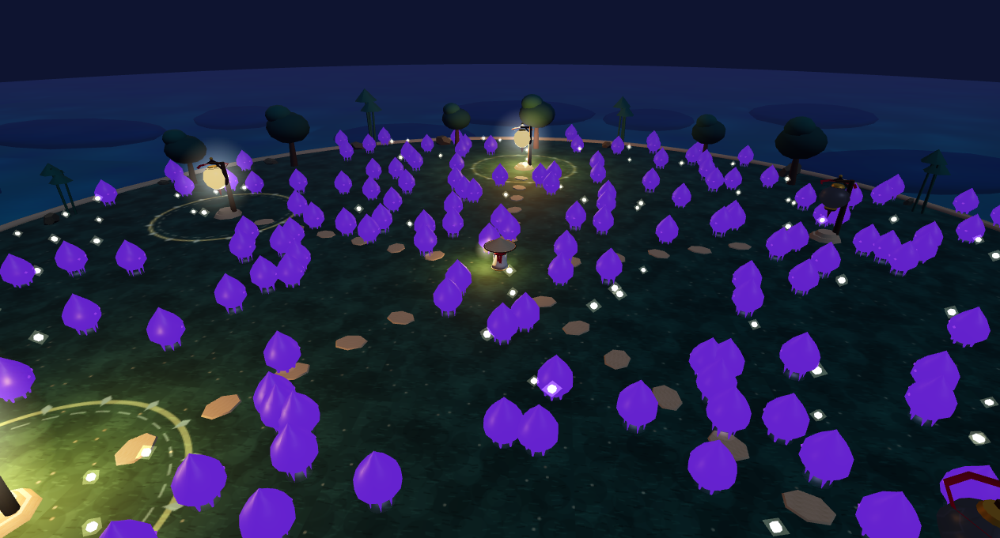

# Đảo Đèn Lồng — v1.0.0 (Phase 4 · Test Contract v1.3)

> **Video demo (< 5 phút):** [Release v1.0.0 trên GitHub](https://github.com/manhquyenkma/K5-L3-LAB-Day12-NguyenManhQuyen-2A202603518-AI-SDLC/releases/tag/v1.0.0) *(hoặc file `docs/demo/demo.mp4`)*



Game 3D góc nhìn thứ ba: **Mây**, người giữ đèn nhỏ tuổi, vượt qua **3 Đêm** (*Đảo Bến*, *Đảo Cau*, *Đảo Chuông*) — gom đom đóm, thắp đèn và châm dầu giữ ánh sáng trước lũ **Bóng Mực hút dầu** và **Gió Lạc** để sống sót tới bình minh với đủ đèn sáng (`≥ 3/5`, `≥ 4/6`, `≥ 5/7`).
Lõi mô phỏng thuần (`src/sim.js`, `src/terrain.js`, `src/nights/*`, `src/entities/*`) dùng chung 100% cho bản chơi 3D (Three.js WebGL2), chế độ **headless** (`headless.js`), **benchmark 3D** (`bench.js`) và **soak test 10 Đêm** (`soak.js`) theo **Test Contract v1.3**.

---

## 1. Yêu cầu hệ thống & Cài đặt (tối đa 3 lệnh từ repo sạch)

- **Yêu cầu hệ thống:** **Node.js ≥ 18** (Windows / macOS / Linux), trình duyệt hỗ trợ **WebGL2** (Google Chrome / Microsoft Edge / Chromium cho `bench.js`).

```bash
npm install --no-audit --no-fund   # 1. Cài duy nhất gói three.js
npm test                           # 2. Chạy toàn bộ 78 test tự động (Phase 1-4 + log vàng)
npm start                          # 3. Mở game tại http://localhost:8080 (bật FPS: http://localhost:8080/?fps)
```

---

## 2. Điều khiển & Dễ tiếp cận (Accessibility)

| Hành động | Phím mặc định | Ghi chú |
|---|---|---|
| Di chuyển 4 hướng | `W / A / S / D` (hoặc mũi tên) | `6.0 m/s` (`7.2 m/s` khi có Bùa Gió); đổi phím được trong Cài đặt |
| Nhảy | `Space` | `7.0 m/s`, chỉ nhảy khi chạm đất |
| **Lướt** | `Shift` | `14 m/s` trong `0.2 s`, hồi chiêu `1.5 s` (không hồi chiêu khi có Bùa Gió) |
| **Tương tác** | `E` | Thắp đèn (`10` lần đầu / `5` thắp lại) hoặc **châm dầu** đèn đang sáng (`+10` dầu/đom đóm) |
| **Tỏa Sáng** | `F` | Tốn `3` đom đóm, bán kính 3D `5 m`, hồi `3 s`: choáng & đẩy Bóng Mực (`+5` / `+15` khi đang `drain`), xua/đòi đồ Gió Lạc |
| Xoay camera | `Q / R` hoặc kéo chuột | Độ nhạy chuột chỉnh được trong Cài đặt |
| **Tạm dừng** | `Esc` (hoặc `P`) | Tiếp tục / Chơi lại Đêm / Cài đặt / Về menu |

### Tính năng Dễ tiếp cận (lưu bền vững trong `localStorage`)
- **Đổi phím điều khiển:** Đổi phím cho đủ 9 hành động, tự động **phát hiện trùng phím** và báo lỗi rõ ràng, có nút **"Khôi phục mặc định"**.
- **Bảng màu dễ phân biệt (Chế độ mù màu):** Đổi viền & mắt Bóng Mực `#7A3CFF → #00B3FF`, cảnh báo UI `#FF5A5F → #FFFFFF` kèm biểu tượng `⚠`; đèn tắt xẹp `20%` và giấy có vết rách răng cưa để phân biệt không cần màu; đèn `fuel < 30` nhấp nháy `1 Hz`.
- **Phụ đề & chỉ báo hình ảnh:** Hiện phụ đề trực tiếp cho **Bóng Mực xuất hiện** (kèm **mũi tên chỉ hướng ở mép màn hình**), **gió sắp thổi**, **10 giây cuối** và **đèn có `fuel < 30`**.
- **Giảm chuyển động:** Tắt rung camera, tắt chớp màn hình và các chuyển động trang trí.
- **Cỡ chữ UI:** Tối thiểu **18 px** ở `1280×720`, kèm tùy chọn **"Chữ lớn (×1.25)"**.

---

## 3. Chế độ Headless, Benchmark, Soak & Bảng xếp hạng (Test Contract v1.3)

### 3.1. Headless CLI (`headless_cmd`)
```bash
node headless.js --seed 1 --night 1 --ticks 600 --out out.jsonl
node headless.js --seed 7 --night 2 --scenario s.json --inputs i.json --ticks 1800 --out out.jsonl --snapshot-every 10
```
Mã thoát: `0` thành công · `1` sai tham số/lỗi chạy · `2` file `--inputs`/`--scenario` sai định dạng (`stderr` có thông báo).

### 3.2. Benchmark 3D (`bench_cmd`)
```bash
node bench.js --seed 42 --duration 30 --out bench.json
```
- Mở cửa sổ `1280×720` không toàn màn hình, truyền cờ Chromium `--disable-gpu-vsync --disable-frame-rate-limit` để **tắt vsync** (`vsync_off: true`; nếu trình duyệt/hệ điều hành khóa cứng DWM compositing thì vẫn ghi nhận đúng tốc độ thực tế).
- Tải Đêm 1 đủ ánh sáng & hiệu ứng với **200 Bóng Mực `wander`** (seed 42), **100 đom đóm**, `L1–L3` sáng (`fuel = 100`), Mây đứng tại `(0,0,0)`, camera bay tròn bán kính `30 m`, cao `Y = 15 m` (15 s/vòng ngược chiều kim đồng hồ). Bỏ `3 s` đầu khởi động, đo đúng `--duration` giây rồi tự thoát mã `0`.
- Kết quả đo thực tế (`bench.json` đính kèm repo trên Intel Iris Xe): **`avg_fps = 133.5`** (ngưỡng `≥ 60`) · **`p1_low_fps = 74.5`** (ngưỡng `≥ 30`) · **`frame_ms_p95 = 9.6 ms`** · **`load_ms = 1903 ms`** (ngưỡng `≤ 10000`).

### 3.3. Soak Test 10 Đêm liên tiếp (`soak_cmd`)
```bash
node soak.js --seed 7 --nights 10 --out soak.json
```
- Chạy headless 10 Đêm liên tiếp (`1 → 2 → 3` xoay vòng, seed `7..16`) trong cùng tiến trình với input ngẫu nhiên theo seed.
- Kết quả thực tế (`soak.json` đính kèm repo): **`crashes = 0`** · **`mem_start_mb = 46.0 MB` → `mem_end_mb = 51.6 MB`** (`1.12× ≤ 1.20×`) · **`duration_s = 0.5 s`**.

### 3.4. Bảng xếp hạng cục bộ & Xuất JSON
- Lưu Top 10 trên đĩa cục bộ (`data/leaderboard.json`), cho nhập tên (`3–12` ký tự `[A-Za-z0-9_]` + hỗ trợ tiếng Việt có dấu) sau màn Bình Minh Đêm 3 hoặc sau khi thua bất kỳ Đêm nào; sắp xếp theo `score` giảm dần (bằng điểm ai đạt trước đứng trên).
- Lệnh xuất chuẩn:
```bash
node server.js --export-leaderboard out.json
```

### 3.5. Đóng gói bản phát hành tĩnh / Docker
```bash
npm run build:release              # Tạo gói tự chạy dist/dao-den-long-v1.0.0/ và dist/dao-den-long-v1.0.0.zip (không cần npm install)
docker build -t dao-den-long:1.0.0 . && docker run --rm -p 8080:8080 dao-den-long:1.0.0
```

---

## 4. Sáng tạo của tôi

Mọi sáng tạo chỉ nằm ở `public/`, **tuyệt đối không sửa luật/số liệu trong `src/`**, được bảo vệ bởi `pure-core-audit`, 3 cổng chặn log vàng byte-by-byte (`tests/phase2/m10-golden.mjs`), và tự động tắt các hạt/hiệu ứng phụ trong cảnh benchmark & soak test:
1. **Mô hình điêu khắc & chất liệu hội họa procedural (`public/assets.js`):** 9 chất liệu `CanvasTexture` tự sinh + hình học `LatheGeometry` (Mây đội nón lá treo đèn mini, miếu Đèn Lồng Hội An, Tháp Chuông 2 tầng mái, Bóng Mực 6 tua mực kết xuất bằng `InstancedMesh` 5 draw calls cho 200+ con, Gió Lạc 7 đốt lụa).
2. **Đảo hát (C1):** Hòa âm thang ngũ cung Web Audio dày dần theo số đèn đang sáng + tiếng chuông tháp khi thắng Đêm 3.
3. **Ông Đăng gợi ý (C2), Hiệu ứng nhân vật (C3) & Không khí từng đảo (C5):** Gợi ý ngắn lần đầu mỗi tình huống, đèn nón lá lắc theo vận tốc, vệt sáng khi lướt, gợn sương khi đáp, cầu tre đung đưa nhẹ, chuông tháp rung khi thắp đèn, màn Bình Minh chuyển sắc trời ấm.

---

## 5. Tài liệu & Bằng chứng theo từng Phase
- **Hợp đồng & Đặc tả:** [game.contract.json](game.contract.json) · [docs/TICKET-02.md](docs/TICKET-02.md) · [docs/TICKET-03.md](docs/TICKET-03.md) · [docs/TICKET-04.md](docs/TICKET-04.md) · [docs/SPEC-PHASE2.md](docs/SPEC-PHASE2.md) · [docs/ASSUMPTIONS.md](docs/ASSUMPTIONS.md)
- **Kiến trúc & Lịch sử thay đổi:** [docs/ADR-001-phase3-lantern-fuel-and-win-rule.md](docs/ADR-001-phase3-lantern-fuel-and-win-rule.md) · [CHANGELOG.md](CHANGELOG.md) · [CREDITS.md](CREDITS.md) · [LICENSE](LICENSE)
- **Đo đạc, Nhật ký AI & Retro:** [bench.json](bench.json) · [soak.json](soak.json) · [docs/PERF.md](docs/PERF.md) · [docs/NOTES.md](docs/NOTES.md) · [docs/RETRO.md](docs/RETRO.md)
- **Bằng chứng kiểm thử:** `evidence/` (Phase 1) · `evidence/phase2/` · `evidence/phase3/` · `evidence/phase4/` · `evidence/golden/`
